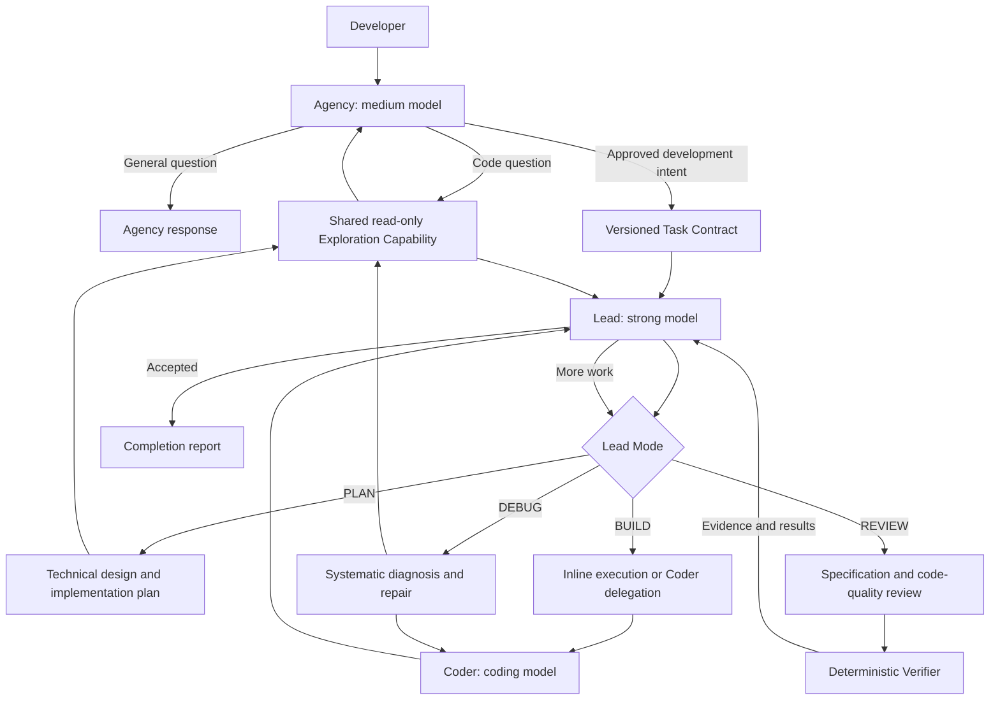
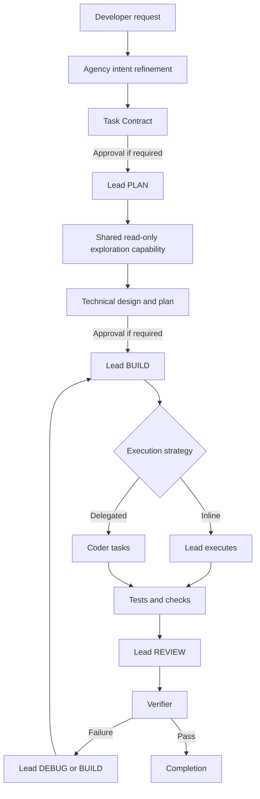

# KUDELMA Agent & Workflow Architecture Specification

**Document ID:** KUD-ARCH-001  
**Version:** 1.1  
**Date:** 2026-11-16  
**Status:** Updated architecture baseline — three-model design  
**Product:** KUDELMA, a local-first, model-agnostic AI engineering orchestrator  
**Revision note:** v1.1 supersedes v1.0 by removing the standalone Explorer LLM role and replacing it with shared deterministic exploration used by Agency and Lead.

> **Product principle:** Simple tasks should remain simple. Complex tasks must follow disciplined engineering workflows.

This document formalizes the agreed KUDELMA architecture. It is intended to be committed to the repository as `docs/architecture/KUDELMA_AGENT_WORKFLOW_SPEC.md` or used as the root architecture specification. The implementation status listed here is based on the project description supplied by the owner; the repository itself has not been independently inspected in this conversation.

---

## 1. Executive Summary

KUDELMA is a Rust-based, local-first AI software development orchestrator. It coordinates three configurable LLM roles with different responsibilities, shared deterministic exploration capabilities, controlled tools, bounded context, and repeatable engineering workflows.

The baseline has **three LLM roles / model profiles**:

1. **Agency** — the medium-capability, user-facing model. It understands and repeatedly refines developer intent, asks targeted clarification questions, creates versioned Task Contracts, and can directly use shared read-only exploration capabilities to answer codebase questions without invoking Lead.
2. **Lead** — the strongest reasoning model and the single technical decision-maker. It owns four internal modes: `PLAN`, `BUILD`, `DEBUG`, and `REVIEW`. It performs its own deep exploration using the same shared exploration capabilities available to Agency, decides when to use Coder, and retains technical decision continuity across modes.
3. **Coder** — a coding-specialized model profile used for bounded implementation tasks. It edits authorized files, follows applicable implementation Skills, runs permitted checks, and returns structured Worker Reports.

**Explorer is not a separate LLM Agent or model profile.** It is the name of a shared, read-only information-exploration capability composed of deterministic retrieval tools, exploration procedures/Skills, and evidence formatting. Agency and Lead can both use it. Agency uses it for routine code questions and requirement context; Lead uses it for deeper architectural, debugging, and review investigations. The reasoning is performed by the calling model (Agency or Lead), not by a fourth Explorer model.

A fourth component, **Verifier**, is not an LLM role. It is a deterministic execution and evidence pipeline for tests, builds, static checks, acceptance checks, and other machine-verifiable conditions.

KUDELMA also contains a **Workflow & Skills Engine**, inspired by the engineering practices popularized by Superpowers. It separates:

- **Agent / model role:** who is doing the work — Agency, Lead, or Coder;
- **Mode:** what phase Lead is currently operating in — PLAN, BUILD, DEBUG, or REVIEW;
- **Skill:** what method or procedure should be followed — TDD, Brainstorming, Systematic Debugging, etc.;
- **Capability:** what reusable function can be invoked — for example, shared read-only exploration;
- **Tool:** what concrete action can be executed — Read, Edit, Bash, MCP, Git;
- **Gate:** what programmatically checked condition must be met before work can progress.

The runtime remains responsible for permissions, state transitions, task routing, evidence capture, and enforcement of hard gates. Skills and model instructions do not grant permissions.

## 2. Goals and Non-Goals

### 2.1 Goals

- Support three independently configurable LLM roles: Agency (medium), Lead (strong), and Coder (coding-specialized). They may use different providers and may be configured to use the same provider when desired.
- Remove the standalone Explorer LLM role and avoid creating a fourth model call merely to perform information retrieval.
- Provide a shared, read-only Exploration Capability that can be used directly by Agency and Lead.
- Let Agency answer ordinary codebase questions without activating Lead.
- Make Lead the single technical decision and general-purpose orchestration authority.
- Preserve Lead's reasoning continuity across planning, implementation, debugging, and review by representing these as modes of the same agent.
- Integrate disciplined engineering practices: brainstorming, plans, TDD, systematic debugging, code review, and verification.
- Load Skills on demand instead of injecting the entire Skill library into every prompt.
- Keep tools and permissions enforceable by Rust code rather than trusting model instructions.
- Transfer context through typed, task-scoped data instead of copying full conversation histories.
- Support both low-cost inline execution and more rigorous Coder-subagent execution.
- Preserve the existing CLI, TUI, Headless, ACP, Provider, MCP, storage, and permission infrastructure where possible.

### 2.2 Non-Goals

- Creating a standalone Explorer LLM Agent or Explorer-specific model profile/session.
- Creating separate Planner, Reviewer, Researcher, or Debugger LLM agents.
- Making Agency the technical architect or allowing it to dispatch Coder.
- Making Coder the owner of requirements, architecture, or task scope.
- Forcing every task through every workflow stage.
- Treating every Skill instruction as a security boundary.
- Sending full Agency conversation history to Lead by default.
- Requiring a cloud service or KUDELMA-managed model API. BYOK and local execution remain first-class.
- Reimplementing every Superpowers feature verbatim or making KUDELMA dependent on the Superpowers repository.
- Claiming that an LLM-generated statement is proof that a test, build, or review actually occurred.

## 3. Core Architecture Concepts

| Concept | Meaning | Example |
|---|---|---|
| LLM role / Agent | A role with a defined objective, model profile, context, and tool policy | Agency, Lead, Coder |
| Mode | Lead's current operating phase | PLAN, BUILD, DEBUG, REVIEW |
| Skill | A reusable procedure or engineering practice, normally stored as `SKILL.md` | TDD, Brainstorming, Systematic Debugging |
| Workflow | A reusable composition of phases, Skills, and gates for a task class | Feature Development, Bug Fix, Refactoring |
| Capability | A reusable operation callable by permitted roles; not necessarily an Agent or model | Shared read-only Exploration Capability |
| Tool | A concrete operation exposed through the tool engine | Read, Edit, Bash, MCP, Git, available code-structure queries |
| Gate | A programmatically checked condition for progressing | Spec approval, test evidence, review completion |
| Task Contract | The developer-approved statement of what should be achieved | Objective, requirements, constraints, acceptance criteria |
| Context Pack | The minimum task-relevant information supplied to a role/capability invocation | Contract, files, decisions, constraints, references |
| Exploration Report | Structured evidence returned by the shared exploration capability | Findings, source locations, relationships, unknowns, coverage |
| Execution Evidence | Machine-recorded proof of an action or result | Test command, exit code, output, revision and diff hash |

These concepts must remain distinct in code and configuration. In particular:

- Exploration is a **capability**, not a fourth LLM role.
- Agency and Lead use their own configured model to interpret exploration results.
- A Skill must not directly grant tools.
- A Mode must not be implemented as a separate LLM role/session by default.
- A Gate must be checked by runtime logic or trusted execution evidence, not merely asserted by a model.

## 4. High-Level System Architecture



The Exploration Capability is shared by Agency and Lead. It performs deterministic retrieval first (existing index/read/search tools, symbol/reference search where implemented, approved web/MCP reads, and Tree-sitter-based source analysis where available), then returns source-grounded evidence. The calling model performs the reasoning and explanation. No separate Explorer LLM call is implied.

### 4.1 Authority model

- Developer: owns intent, approval, and high-impact decisions.
- Agency: owns clarification and intent refinement; may answer code questions using bounded read-only exploration; does not own technical implementation decisions.
- Lead: owns technical decisions, workflow decisions, general-purpose task dispatch, deep investigation, and final task disposition.
- Coder: implements a bounded task; does not redefine requirements or expand scope.
- Exploration Capability: supplies retrieved facts and evidence; it has no independent model authority or decision-making authority.
- Verifier: produces machine-derived evidence; does not make product or architecture decisions.
- Permission Engine: has final authority over whether an operation is allowed, regardless of Agent, Skill, Mode, or `--yolo`.

Only Lead may dispatch general-purpose Coder tasks. Agency has one narrowly scoped exception to the normal dispatch rule: it may invoke the shared Exploration Capability for bounded, read-only information retrieval to answer a developer's question or gather factual context for clarification. This is a capability invocation, not an Agent spawn. Agency cannot dispatch Coder or invoke arbitrary nested agents.

## 5. Agent and Capability Specifications

### 5.1 Agency

**Role:** User-facing intent refinement and communication.  
**Recommended model class:** Medium-capability, instruction-following, low-latency and cost-efficient general model.  
**Session:** Independent persistent conversation session, separate from Lead.

#### Responsibilities

- Classify incoming developer messages and distinguish questions from requests for work.
- Identify the user's underlying intent and desired outcome.
- Ask targeted clarification questions where ambiguity materially affects behavior, scope, architecture, compatibility, or acceptance.
- Avoid asking questions that have already been answered.
- Use safe, explicit assumptions for low-impact unknowns and record them in the Task Contract.
- Maintain a concise history of confirmed user decisions.
- Answer general questions directly when no project inspection is needed.
- Use the shared read-only Exploration Capability to answer codebase questions without activating Lead.
- Use exploration findings to understand project context relevant to a feature request.
- Create or update a versioned Task Contract for actionable development requests.
- Hand the ready/approved Task Contract to Lead.

#### Non-Responsibilities

- Does not make final architecture or implementation decisions.
- Does not write or edit project source files.
- Does not execute arbitrary shell commands.
- Does not dispatch Coder or create/spawn LLM agents.
- Does not change permissions or project trust state.
- Does not decide whether a technical plan is correct; Lead owns that decision.

#### Clarification policy

Agency should optimize for **minimum sufficient clarification**, not maximum questioning.

1. Ask a question only when the answer can materially change the expected result or implementation constraints.
2. Prefer one clear question per turn where practical.
3. Offer a recommended default when it helps the developer decide.
4. Record low-risk assumptions instead of blocking progress.
5. Stop clarification when the Task Contract is sufficiently actionable.
6. If important ambiguity remains, keep the contract in `needs_clarification`; do not silently mark it approved.
7. Apply a configurable clarification-turn budget. Reaching the budget must trigger a concise summary of unresolved decisions, not fabricated certainty.

#### Agency routing categories

| Intent | Behavior |
|---|---|
| `general_question` | Answer directly from current context or general knowledge |
| `code_question` | Use shared read-only exploration, then explain evidence to developer; do not invoke Lead |
| `architecture_question` | Explore and explain the current architecture; invoke Lead only if the user requests a technical decision, plan, or change |
| `feature_request` | Clarify intent, create Task Contract, obtain required approval, hand off to Lead |
| `bug_report` | Collect symptoms, reproduction details, expected/actual behavior, then hand off to Lead in DEBUG-ready form |
| `change_request` | Clarify the requested delta and update/version the existing contract |
| `planning_request` | Clarify desired outcome, then hand off to Lead for PLAN |
| `status_question` | Read current task/session status without starting a new development task |

### 5.2 Lead

**Role:** Single technical authority, deep investigator, and orchestrator.  
**Recommended model class:** Strongest available reasoning and coding model.  
**Session:** Main technical session, retained across Lead modes.

#### Responsibilities

- Receive ready/approved Task Contracts from Agency.
- Inspect project state and determine what additional evidence is required.
- Use the shared Exploration Capability directly for deep codebase, documentation, external technical, and runtime investigation.
- Select and transition between PLAN, BUILD, DEBUG, and REVIEW.
- Make architecture and implementation decisions.
- Select applicable Skills and Workflows.
- Decide whether to work inline or delegate to Coder.
- Dispatch Coder for scoped implementation.
- Coordinate task dependencies and bounded parallel execution.
- Review implementation results and execution evidence.
- Decide whether to continue, retry, change plan, request developer input, or complete the task.
- Produce the final developer-facing report.

#### Non-Responsibilities

- Does not replace the Permission Engine.
- Does not treat Coder reports or retrieved facts as verified without checking their evidence.
- Does not delegate final technical authority to Coder.
- Does not need to spawn a new model agent for each Mode or for ordinary information retrieval.

#### Lead authority

Lead is the only general-purpose LLM agent dispatcher. It may invoke Coder and the shared Exploration Capability. It may choose inline implementation for small tasks if the runtime's tool policy permits it. All delegated work remains subordinate to the Task Contract and current workflow.

### 5.3 Shared Exploration Capability (not an Agent)

**Type:** Read-only information retrieval and evidence preparation capability.  
**LLM model:** None assigned. Agency or Lead uses its own model to reason over retrieved evidence.  
**Invocation:** Direct capability call by Agency or Lead; no Explorer Agent, independent model profile, or Explorer LLM session is created.

The capability combines deterministic tools, retrieval procedures, applicable Skills, and a common evidence/report formatter. It is not a separate decision-maker.

#### Investigation domains

1. **Codebase exploration:** file discovery, symbol references, call chains, scene/resource relationships, dependencies, signal connections, configuration, and architecture facts.
2. **Code explanation:** explain functions, data flow, state transitions, event handling, and cross-module behavior using retrieved source evidence.
3. **Technical research:** official documentation, API behavior, version compatibility, library usage, upstream issues, and external technical sources.
4. **Runtime investigation:** logs, stack traces, test failures, crash output, and observed execution state.
5. **Project knowledge retrieval:** design documents, confirmed decisions, development conventions, prior fixes, and project constraints.

#### Execution model

1. Prefer deterministic retrieval first: project index, available AST/symbol queries, `glob`, `grep`, `read`, `ls`, and approved documentation/runtime sources. Where current indexing lacks source-aware structure, add Tree-sitter-based analysis incrementally.
2. Return bounded source-grounded evidence to the caller.
3. Agency interprets evidence using its medium model for ordinary explanations and requirement context.
4. Lead interprets evidence using its strong model for architecture, debugging, and implementation decisions.
5. If the caller cannot reach a reliable conclusion, it may request a broader investigation, gather more evidence, or escalate the decision to Lead. Do not silently create a separate Explorer model.

#### Output requirements

- Distinguish observed facts from inferences and unknowns.
- Include file paths, symbol names, line ranges, or external source references where available.
- Describe relevant relationships such as function calls, signals, dependencies, and data flow.
- State investigation scope and meaningful coverage gaps.
- Report uncertainty rather than inventing missing details.

#### Restrictions

- Read-only by default; no project source modification.
- Cannot create or dispatch agents.
- Cannot approve architecture or change requirements.
- Does not own a separate model, provider configuration, token budget, or persistent Agent session.
- Cannot claim a test passed unless it has trusted execution evidence from Verifier or another authorized execution tool.
- External research must identify source and version/date where relevant.

Agency and Lead invoke the same underlying capability with different caller context and output detail. The tool/retrieval layer is shared; the reasoning remains in the calling Agent's own session.

### 5.4 Coder

**Role:** Scoped implementation worker.  
**Recommended model class:** Coding-specialized model with sufficient implementation quality and cost efficiency.  
**Session:** Task-scoped; normally fresh for each independent task.

#### Responsibilities

- Implement a clearly specified task.
- Read relevant files and project instructions.
- Edit only authorized paths and files.
- Follow applicable implementation Skills, including TDD where appropriate.
- Run explicitly authorized tests and checks.
- Return a structured Worker Report with changed files, tests, unresolved issues, assumptions, and evidence references.

#### Restrictions

- Cannot dispatch agents or invoke general-purpose agent orchestration.
- Cannot alter the Task Contract.
- Cannot widen its own scope.
- Cannot change global/project permission rules.
- Cannot claim completion based only on generated text.
- Must stop and report when requirements conflict, scope is insufficient, or implementation reveals a material design issue.

### 5.5 Verifier (non-LLM subsystem)

Verifier is a deterministic runtime subsystem, not an LLM role.

It executes and records:

- tests;
- builds and compilation;
- format and lint checks;
- parser/static analysis checks;
- project-specific validation commands;
- acceptance checks that can be expressed deterministically;
- Git state and diff checks;
- workflow gate evidence.

Verifier reports results to Lead. It does not infer product intent or independently approve a design.

## 6. Lead Modes and State Transitions

PLAN, BUILD, DEBUG, and REVIEW are states of the same Lead agent. Switching Mode changes the active instructions, Skill selection, tool posture, and workflow expectations; it does not create another agent or automatically reset the Lead session.

### 6.1 PLAN

**Purpose:** Decide what should be changed and how.

Typical Skills:

- technical brainstorming (after Agency has refined user intent);
- writing-plans;
- shared read-only exploration capability (deterministic retrieval; Lead interprets evidence);
- architecture and dependency analysis.

Expected outputs:

- technical design where needed;
- implementation plan;
- task graph and dependencies;
- file/scope map;
- test and verification strategy;
- identified risks and unresolved decisions.

Default posture: read-only. Any required write operation (for example, saving a design document) must still pass normal permission checks.

### 6.2 BUILD

**Purpose:** Implement the approved plan or task.

Typical Skills:

- executing-plans;
- subagent-driven-development;
- test-driven-development (when applicable);
- using-git-worktrees (when isolation or parallelism is needed).

Execution strategies:

- **Inline:** Lead performs a small, cohesive change itself.
- **Delegated:** Lead assigns bounded tasks to one or more Coders.

Lead selects the strategy based on task complexity, coupling, risk, context cost, and file conflicts. Parallel Coder execution is allowed only when task dependencies and workspace isolation are clear.

### 6.3 DEBUG

**Purpose:** Identify root cause and repair defects systematically.

Typical Skills:

- systematic-debugging;
- regression-test design;
- TDD for the fix;
- targeted use of the shared Exploration Capability.

Expected sequence:

1. Reproduce or characterize the failure.
2. Collect logs, traces, relevant state, and versions.
3. Form and test hypotheses.
4. Identify root cause with evidence.
5. Add a regression test when feasible.
6. Implement the smallest root-cause fix.
7. Run regression and relevant broader checks.
8. Return to REVIEW.

Lead must not use repeated speculative code edits as a substitute for diagnosis.

### 6.4 REVIEW

**Purpose:** Independently assess whether implementation satisfies the contract and is technically sound.

Lead performs two review passes:

1. **Specification Compliance Review:** compare the approved Task Contract and plan with the actual diff and observed behavior.
2. **Code Quality Review:** examine correctness, maintainability, architecture consistency, error handling, resource management, performance, and security concerns relevant to the change.

Review should use a bounded, refreshed Review Context Pack containing the approved contract, relevant design/plan, task specification, Git diff, changed-file list, and actual verification evidence. It should exclude irrelevant implementation chat and Coder internal reasoning.

This is a fresh review context for the same Lead role, not a separate Reviewer agent. Critical or high-risk work may optionally use an additional independent provider/model as a configurable enhancement, but that is not required for the baseline architecture.

### 6.5 Mode transition rules

Lead chooses transitions dynamically. The runtime records the selected Mode and transition reason.

Common paths:

- Simple change: `BUILD -> REVIEW`
- Feature: `PLAN -> BUILD -> REVIEW`
- Bug fix: `DEBUG -> BUILD -> REVIEW`
- Complex bug: `DEBUG -> PLAN -> BUILD -> DEBUG -> REVIEW`
- Design failure: `REVIEW -> PLAN`
- Implementation failure: `REVIEW -> DEBUG` or `REVIEW -> BUILD`

No fixed linear pipeline is mandatory for every task. However, mandatory gates cannot be skipped by a model response alone.

---

## 7. Workflow & Skills Engine

### 7.1 Design rule

The Skills Engine adapts Superpowers-style engineering practices into a native KUDELMA capability. It is not another LLM and does not itself make a model more intelligent.

It provides:

- Skill discovery and metadata;
- on-demand Skill loading;
- agent/mode applicability;
- reusable workflow definitions;
- workflow state and transition tracking;
- mandatory/optional Skill policy;
- execution evidence and completion conditions.

### 7.2 Skill versus Workflow

- A **Skill** describes how to perform a particular kind of work.
- A **Workflow** composes Skills, Modes, and gates for a task class.

Examples:

| Skill | Typical agent/mode | Purpose |
|---|---|---|
| `intent-refinement` | Agency | Clarify user intent and create contract |
| `codebase-question-answering` | Agency | Answer project questions using shared exploration evidence |
| `technical-brainstorming` | Lead / PLAN | Explore technical approaches and trade-offs |
| `writing-plans` | Lead / PLAN | Produce small, executable implementation steps |
| `executing-plans` | Lead / BUILD | Execute an approved plan step by step |
| `subagent-driven-development` | Lead / BUILD | Delegate isolated tasks and review each result |
| `test-driven-development` | Lead or Coder / BUILD, DEBUG | RED-GREEN-REFACTOR |
| `systematic-debugging` | Lead / DEBUG | Find root cause before changing code |
| `requesting-code-review` | Lead / REVIEW | Inspect implementation against requirements and quality criteria |
| `verification-before-completion` | Lead / REVIEW | Verify results before claiming completion |
| `using-git-worktrees` | Lead / BUILD | Isolate parallel or risky work |
| `finishing-development-branch` | Lead / REVIEW | Decide merge, retain, or clean up a work branch |

No standalone Planner, Reviewer, Researcher, or Debugger agent is created for these Skills.

### 7.3 Skill loading lifecycle

1. **Bootstrap:** inject a short instruction that Skills are available and should be discovered when relevant.
2. **Discovery:** query Skill metadata (name, description, triggers, applicable roles/modes, priority).
3. **Selection:** choose Skills applicable to current task and Mode.
4. **Loading:** load the full Skill instructions only when selected.
5. **Execution:** follow the procedure using authorized tools.
6. **Evidence:** record relevant outputs and gate evidence.
7. **Completion:** check Skill completion conditions and update workflow state.

Do not load the full Skill library into every Agent context. Do not inject unrelated Skills.

### 7.4 Skill metadata format

The following is an illustrative format. The parser may support a compatible subset of standard `SKILL.md` frontmatter while retaining KUDELMA-specific metadata.

```yaml
---
name: test-driven-development
description: Use for behavior changes and testable bug fixes.
applies_to:
  agents: [lead, coder]
  modes: [build, debug]
priority: required_when_applicable
triggers:
  - behavior_change
  - regression_fix
requires:
  - relevant_test_runner
produces:
  - test_evidence
  - implementation_changes
---

# Test-Driven Development

Follow RED-GREEN-REFACTOR...
```

### 7.5 Skill sources and trust

Support three sources:

1. **Built-in Skills:** shipped with KUDELMA and versioned with the application.
2. **User Skills:** explicitly installed or configured by the user.
3. **Project Skills:** stored in the project, such as `.kudelma/skills/`.

Trust policy:

- Project Skills in an untrusted project must not be automatically loaded as executable authority.
- Untrusted project Skills may be inspected as data only under a safe policy; they cannot grant tools or permissions.
- A Skill cannot override global deny rules, project trust restrictions, permission policies, or approval requirements.
- Skills must never receive API credentials merely because their instructions request them.
- Skill instructions are untrusted content for security purposes; all tool operations remain subject to the Permission Engine.
- If distributing copied upstream Superpowers Skill text, comply with its applicable license and attribution requirements. Prefer native KUDELMA-authored Skills inspired by the methodology, while supporting compatible Skill formats.

### 7.6 Applicability policy

Avoid blindly applying every Skill to every task.

- Required Skills must run when their trigger conditions apply.
- Optional Skills may be skipped with a brief recorded reason.
- Inapplicable Skills should not be loaded.
- Low-risk/simple tasks may use a lightweight workflow.
- Security, permission, and verification constraints are not optional merely because the task is simple.

---

## 8. Built-in Workflows

### 8.1 Feature Development



Typical Skills: `intent-refinement`, `technical-brainstorming`, `writing-plans`, `executing-plans` or `subagent-driven-development`, `test-driven-development` where applicable, `requesting-code-review`, `verification-before-completion`.

### 8.2 Bug Fix

1. Agency collects expected behavior, actual behavior, reproduction steps, environment, and relevant recent changes.
2. Lead enters DEBUG.
3. Lead uses the shared Exploration Capability to gather code/log/test evidence.
4. Lead reproduces or characterizes the failure and tests hypotheses.
5. Add a regression test where feasible.
6. Lead or Coder implements the root-cause fix.
7. Lead enters REVIEW; Verifier runs relevant tests.
8. If evidence fails, return to DEBUG or BUILD.

Typical Skills: `systematic-debugging`, `test-driven-development`, `requesting-code-review`, `verification-before-completion`.

### 8.3 Refactoring

1. Agency clarifies what may and may not change.
2. Lead PLAN maps dependencies and behavior to preserve.
3. Lead uses the shared Exploration Capability to identify references, interfaces, and affected modules.
4. Establish baseline tests/checks where feasible.
5. Use Git Worktree for risky or parallel work.
6. Lead/Coder refactors incrementally.
7. Run regression checks after each meaningful unit.
8. Lead REVIEW checks behavioral compatibility and diff scope.
9. Verifier records final evidence.

### 8.4 Codebase Question

1. Developer asks a question about existing code.
2. Agency classifies it as `code_question`.
3. Agency invokes the shared Exploration Capability with a bounded, read-only query.
4. The capability returns evidence and citations to project files; Agency interprets them using its own medium model.
5. Agency explains the answer to the developer.
6. Lead is not activated unless the user asks for a technical decision, plan, or code change.

### 8.5 Simple Task

For small, unambiguous changes, Agency may produce a lightweight contract or use an existing confirmed intent. Lead may go directly to BUILD, then REVIEW/verification according to risk. Full Brainstorming and multi-agent execution are not mandatory.

---

## 9. Agent Communication Contracts

Agents should communicate through typed, persisted objects rather than arbitrary full-history copying.

### 9.1 Task Contract (Agency -> Lead)

Minimum fields:

```yaml
contract_version: 1
contract_id: "..."
status: needs_clarification | ready_for_lead | approved | superseded
source_session_id: "..."

intent:
  summary: "..."
  goals: []
  requirements: []
  non_goals: []

constraints: []
decisions: []
assumptions: []
unresolved_questions: []
acceptance_criteria: []

approval:
  developer_confirmed: false
  approved_at: null

references:
  conversation_messages: []
  project_files: []
```

Rules:

- Contract changes create a new version or revision; they do not silently erase prior approved decisions.
- `ready_for_lead` means sufficiently actionable; `approved` is required only where policy says developer approval is necessary.
- Lead may return a contract for clarification with specific questions, but Agency remains responsible for asking the developer.
- Lead may identify technical constraints during PLAN; changes to the developer's desired behavior must be returned through Agency for confirmation.

### 9.2 Context Pack

A Context Pack is assembled for each Agent invocation. It should include only what is needed:

- caller and purpose;
- Task Contract or task specification;
- relevant project instructions and trust state;
- relevant project memory and confirmed decisions;
- relevant files/symbols/logs/docs;
- allowed paths and tools;
- acceptance criteria;
- references to source sessions rather than full histories;
- output schema expected from the Agent.

The Context Pack must label information as **confirmed fact**, **observed evidence**, **assumption**, or **unknown**. It must not transform an inference into a confirmed decision.

### 9.3 Worker Task (Lead -> Coder)

Minimum fields:

```yaml
task_id: "..."
parent_contract_id: "..."
objective: "..."
requirements: []
constraints: []
context_refs: []
allowed_paths: []
forbidden_paths: []
allowed_tools: []
dependencies: []
acceptance_criteria: []
required_skills: []
max_retries: 1
```

### 9.4 Exploration Request and Report (shared capability)

This protocol describes a capability invocation, not a separate Explorer Agent or model call. `caller` must be `agency` or `lead`; the caller's own model interprets the returned evidence.

Exploration Request:

```yaml
request_id: "..."
caller: agency | lead
investigation_mode: codebase | code_explanation | technical_research | runtime_investigation | project_knowledge
objective: "..."
questions: []
scope:
  paths: []
  symbols: []
  sources: [codebase, documentation, runtime, project_memory]
limits:
  read_only: true
  max_files: 30
  max_results: 100
expected_output: findings_with_evidence
```

Exploration Report:

```yaml
request_id: "..."
status: completed | partial | blocked
summary: "..."
findings:
  - id: "F-001"
    claim: "..."
    kind: observed_fact | inference
    evidence:
      - file: "..."
        symbol: "..."
        lines: [1, 10]
    confidence: high | medium | low
relationships: []
unknowns: []
coverage:
  searched_files: []
  searched_symbols: []
  omitted_or_unavailable: []
external_sources: []
```

Rules:

- Deterministic retrieval should be attempted before spending model tokens on simple lookup.
- The capability itself does not call an LLM. Agency or Lead performs reasoning over the report using its assigned model.
- `observed_fact` requires direct evidence. `inference` must identify supporting evidence and must not be represented as confirmed fact.
- File/line references should be supplied where available; external research should include source and version/date where relevant.
- Incomplete coverage must be stated. Do not fabricate certainty when files, symbols, logs, or external sources are unavailable.
- Reports may be cached/reused only while their source revision and relevant file hashes remain valid.

### 9.5 Worker Report

```yaml
task_id: "..."
status: completed | partial | blocked | failed
summary: "..."
modified_files: []
tests:
  executed: []
  passed: []
  failed: []
assumptions: []
unresolved_issues: []
evidence_refs: []
```

A Worker Report is a claim plus references. Verifier evidence remains authoritative for executable checks.

---

## 10. Context Management and Session Lifecycles

### 10.1 Session separation

- Agency has its own persistent session for user intent, clarification history, and approved decisions.
- Lead has its own persistent technical session and retains continuity across PLAN/BUILD/DEBUG/REVIEW modes.
- Exploration Capability has no independent model session; its retrieval requests and reports are scoped to the calling Agency or Lead task.
- Coder uses task-scoped sessions, preferably fresh for independent tasks.

### 10.2 No default full-history forwarding

Lead does not receive the entire Agency conversation. It receives the ready/approved Task Contract, relevant confirmed decisions, and source references. Agency and Lead invoke the shared Exploration Capability with bounded requests; no separate Explorer session is created. Coder receives a task-specific Context Pack.

### 10.3 Project Memory

Project Memory may include:

- architecture and module map;
- project-specific development conventions;
- confirmed technical decisions;
- known issues and constraints;
- relevant toolchain and runtime versions.

Memory entries must carry provenance and status (confirmed, inferred, superseded). Current source code and explicit developer instructions take precedence over stale memory.

### 10.4 Compaction

Compaction should preserve:

- active Task Contract and its version;
- current Lead Mode and workflow state;
- completed and pending task IDs;
- confirmed decisions;
- current assumptions and unresolved questions;
- relevant changed files and evidence references;
- retry counts and budget state.

Avoid retaining long raw tool outputs when a source reference or compact evidence summary is sufficient.

---

## 11. Tool Permissions and Security Boundaries

The existing `kudelma-permissions` crate remains the single enforcement point.

### 11.1 Default capability matrix

| Capability | Agency | Lead | Coder | Verifier |
|---|---:|---:|---:|---:|
| Read project files | bounded | yes | yes | bounded |
| Shared read-only exploration | yes, bounded | yes | task-scoped reads | no direct orchestration |
| Write/edit project files | no | policy-controlled | scoped | no |
| Shell/Bash | no by default | policy-controlled | approved/scoped | controlled command set |
| External fetch | optional/policy | yes if enabled | normally no | no |
| MCP | read-only subset, if enabled | policy-controlled | task-specific subset | no by default |
| Dispatch Coder | no | yes | no | no |
| Spawn/dispatch LLM agents | no | Coder only | no | no |
| Change permissions | no | no | no | no |
| Change project trust | no | no | no | no |

### 11.2 Enforcement invariants

- Deny rules take precedence over allow rules.
- Agent tool allowlists never exceed global, project, and user policy.
- A Skill cannot grant a tool or change an approval requirement.
- `--yolo` does not disable deny rules, path traversal protection, untrusted-project restrictions, or other non-bypassable safety controls.
- Symlink escape protection remains active for all agents.
- Untrusted projects do not load project-level Provider, Hooks, MCP, or Skills as trusted configuration.
- Agency's use of the shared Exploration Capability is read-only and bounded; it is not an Agent spawn.
- Coder path scope is checked by the runtime/permission layer, not merely stated in its prompt.
- Destructive operations and external publication remain subject to the existing approval policy.

---

## 12. Workflow Gates and Verification Evidence

### 12.1 Gate types

| Gate | Typical condition | Enforcement |
|---|---|---|
| Contract Gate | Contract sufficiently clear; required approval obtained | Workflow Controller |
| Design Gate | Required design decision reviewed/approved | Policy + developer approval |
| Plan Gate | Plan exists and dependencies are coherent | Workflow Controller; approval by risk policy |
| TDD RED Gate | Relevant test was executed and failed for expected behavior | Verifier evidence |
| TDD GREEN Gate | Relevant test passes after implementation | Verifier evidence |
| Review Gate | Spec and quality review completed; blockers resolved | Lead decision + recorded review |
| Verification Gate | Required build/tests/checks pass | Verifier |
| Finish Gate | Branch/merge/cleanup decision is explicit | Lead + Git/tool policy |

### 12.2 Evidence record

For each executable verification step, capture where available:

- command or check identifier;
- working directory;
- start/end timestamp;
- exit code;
- stdout/stderr or durable artifact reference;
- Git HEAD or relevant revision;
- diff hash or changed-file snapshot;
- test/check identity;
- result: passed, failed, skipped, blocked;
- skip reason when applicable.

The runtime must not accept an LLM statement such as `tests_passed: true` as a substitute for actual execution evidence.

### 12.3 TDD applicability

TDD is required when applicable to testable behavior changes and regression fixes, but it is not mechanically forced onto every task.

Examples:

- business logic, state transitions, data conversion, save compatibility: prefer tests first;
- bug fixes: add a regression test where feasible;
- UI layout, animation, lighting, visual composition: use runtime/visual validation where unit tests are insufficient;
- documentation and simple configuration: use appropriate structural or lint checks.

If TDD is skipped, record why it is not applicable or why a suitable test harness is unavailable. Do not fabricate RED/GREEN evidence.

---

## 13. Adaptive Routing and Cost Controls

### 13.1 Task complexity levels

| Level | Example | Suggested route |
|---|---|---|
| L0 | Explain a GDScript function | Agency -> deterministic exploration -> Agency explanation; no Lead |
| L0 | Rename a local variable | Lead BUILD, then proportionate verification |
| L1 | Small UI or isolated function | Agency lightweight refinement -> Lead BUILD -> proportionate review/check |
| L2 | New feature module | Agency -> Lead PLAN -> shared exploration as needed -> BUILD -> REVIEW -> Verifier |
| L3 | Core architecture refactor | Agency -> Lead PLAN -> deep shared exploration -> design/plan gates -> isolated BUILD -> REVIEW -> full verification |
| Bug | Runtime crash or incorrect behavior | Agency symptom collection -> Lead DEBUG -> shared exploration -> fix -> REVIEW -> Verifier |

These levels guide routing; Lead remains free to change course based on evidence. Complexity levels are workflow policies, not model tiers.

### 13.2 Three-model routing

The baseline has three configurable model profiles:

- **Agency model (medium):** handles user communication, intent refinement, code explanations, and interpretation of ordinary exploration results.
- **Lead model (strong):** performs technical decisions, deep investigation, planning, debugging, review, and orchestration.
- **Coder model (coding-specialized):** implements bounded tasks. Lead may bypass Coder and implement small changes inline.

The Exploration Capability has **no model profile**. It runs deterministic retrieval first. The calling Agency or Lead model performs reasoning over returned evidence. This avoids the cost and context handoff of a separate Explorer LLM.

The model profiles are independently configurable by provider and model ID; they do not have to use three different vendors. A user may configure the same model/provider for multiple roles, but the logical responsibilities and context boundaries remain distinct.

### 13.3 Execution strategy

Lead selects:

- **Inline execution** for small, cohesive, low-conflict tasks;
- **Coder-delegated execution** for bounded tasks where a separate coding context or different coding model provides value.

Parallel Coder work requires:

- explicit task dependencies;
- non-overlapping file ownership or isolated worktrees;
- bounded parallelism;
- clear merge/integration ownership;
- a final integrated verification step.

Agency may use the shared Exploration Capability directly for code questions and requirement context. It must not create a model subagent or dispatch Coder.

### 13.4 Exploration cost policy

- Prefer deterministic retrieval (index, available AST/symbol search, grep, glob, read) for simple lookup; extend source-aware indexing only where needed.
- Do not call a model merely to locate a file, symbol, or literal reference when deterministic tools can answer it.
- Agency interprets ordinary exploration results with its medium model.
- Lead interprets complex architecture, cross-module, runtime, and debugging evidence with its strong model.
- If Agency cannot answer reliably, it should state the limitation and, where the user's request requires technical judgment, hand a concise evidence-backed request to Lead. It must not silently invoke a fourth model.
- Escalation is based on evidence gaps, ambiguity, impact, and risk—not on answer length.

### 13.5 Budgets

Support configurable limits for:

- per-role turns/tokens/cost;
- per-task total cost;
- clarification rounds;
- Lead plan/review retries;
- Coder retries;
- parallel Coder count;
- exploration files/results/rounds;
- wall-clock time.

When a budget is exceeded, stop safely and request approval or report the blocker. Do not silently discard requirements or lower verification standards to fit the budget.

## 14. Configuration Sketch

Illustrative TOML only; exact keys must be reconciled with the existing config schema before implementation. There are three model profiles; Exploration is a shared capability and has no independent provider/model entry.

```toml
[agency]
provider = "openai-compatible"
model = "agency-medium-model"
max_turns = 10
max_clarification_rounds = 8

[lead]
provider = "anthropic"
model = "lead-strong-model"
max_turns = 40
max_children = 3

[agents.coder]
provider = "openai-compatible"
model = "coding-model"
max_turns = 25
can_spawn = false

[exploration]
enabled = true
read_only = true
prefer_deterministic_retrieval = true
max_files = 30
max_results = 100
max_investigation_rounds = 5
allow_external_fetch = true

[workflow]
default = "adaptive"
require_review = true
require_verification = true
require_spec_approval = "risk_based"
require_plan_approval = "medium_and_above"

[workflow.execution]
strategy = "adaptive"
max_parallel_coders = 3
fresh_coder_per_task = true
review_after_each_task = true

[skills]
enabled = true
lazy_loading = true
project_skills_require_trust = true

[skills.builtins]
intent_refinement = true
brainstorming = true
writing_plans = true
executing_plans = true
subagent_driven_development = true
test_driven_development = true
systematic_debugging = true
requesting_code_review = true
verification_before_completion = true
using_git_worktrees = true
finishing_development_branch = true
```

Configuration values are policy inputs, not permission bypasses. Secret values remain in the credential storage system, not TOML. `exploration` config controls retrieval bounds and sources, not an Explorer model or agent.

## 15. CLI and TUI Integration

The existing CLI commands remain the primary interface. Proposed additions:

```bash
kudelma skill list
kudelma skill inspect <name>
kudelma skill enable <name>

kudelma workflow list
kudelma workflow inspect <name>
kudelma workflow resume <id>

kudelma task inspect <id>
kudelma task history <id>
```

TUI should expose:

- current active Agent;
- Lead Mode;
- current Workflow and stage;
- selected/loaded Skills;
- pending approvals;
- active shared-exploration requests and Coder tasks;
- task dependencies and progress;
- model/provider and cost/token usage;
- verification state and evidence;
- transition reason, such as `BUILD -> DEBUG: integration test failed`.

Do not overload the TUI with every internal prompt or raw model thought. Show actionable state, decisions, evidence, and user approvals.

---

## 16. Rust Workspace Mapping

The architecture should reuse the existing workspace and avoid unnecessary crate proliferation. The reported existing `kudelma-tools` crate already supplies basic deterministic retrieval primitives such as index/read/glob/grep/ls; the new design should compose and extend them rather than create a duplicate Explorer agent implementation. Source-aware AST/symbol indexing may be added incrementally where current indexing is insufficient.

| Existing crate/module | Responsibility in this design |
|---|---|
| `kudelma-config` | Agency/Lead/Coder model profiles, exploration bounds, Skill sources, workflow policy, budgets |
| `kudelma-storage` | Agency/Lead/Coder sessions, Task Contracts, exploration report cache/references, Skills metadata/cache, workflow state, execution ledger |
| `kudelma-providers` | Independent provider/model configuration for the three LLM roles |
| `kudelma-permissions` | Final authority for all tool operations, including Agency's bounded read-only exploration |
| `kudelma-tools` | Existing tools; add/compose deterministic symbol, relationship, and evidence retrieval where needed |
| `kudelma-core` | Three LLM roles, Lead modes, shared exploration capability, orchestration, Skills and Workflow engines, Context Packs |
| `kudelma-tui` | Agency interaction, Lead mode/status, approvals, exploration activity, Skills/workflow visibility |
| `kudelma-acp` | Expose the same runtime and workflow state to IDE clients |
| `src/` | CLI commands and Headless routing |

Suggested logical organization inside `kudelma-core`:

```text
src/
├── agents/
│   ├── agency.rs
│   ├── lead.rs
│   └── coder.rs
├── lead/
│   ├── mode.rs
│   ├── transitions.rs
│   └── context.rs
├── exploration/
│   ├── request.rs
│   ├── executor.rs
│   ├── evidence.rs
│   ├── relationships.rs
│   └── cache.rs
├── skills/
│   ├── registry.rs
│   ├── parser.rs
│   ├── loader.rs
│   ├── resolver.rs
│   └── trust.rs
├── workflows/
│   ├── controller.rs
│   ├── state.rs
│   ├── feature.rs
│   ├── bug_fix.rs
│   └── refactor.rs
├── orchestration/
│   ├── task_contract.rs
│   ├── task_spec.rs
│   ├── context_pack.rs
│   ├── task_graph.rs
│   ├── dispatcher.rs
│   └── execution_ledger.rs
└── verification/
    ├── runner.rs
    ├── evidence.rs
    └── gates.rs
```

`exploration/` is a capability module, not an Agent module. It must not define `ExplorerAgent`, an Explorer model profile, or an independent Explorer LLM session. Agency and Lead call the same request/execution/evidence interfaces with different caller context and output detail.

## 17. Migration from the Existing Agent Implementation

The reported current implementation already has `explore`, `plan`, and `coder` subagents. Migration should preserve useful retrieval and implementation behavior while eliminating the standalone Explorer and Planner LLM roles.

| Existing role/module | Target architecture | Migration |
|---|---|---|
| Main agent | Lead | Keep; add internal PLAN/BUILD/DEBUG/REVIEW Mode Controller and direct access to shared exploration |
| `explore` subagent | Shared Exploration Capability | Retire as a standalone LLM agent; preserve and reuse its retrieval tools/prompts as read-only exploration procedures, Skills, and evidence formatting |
| `plan` subagent | Lead PLAN Mode | Retire as a separate LLM role; migrate planning instructions into Lead PLAN Skills and workflow |
| `coder` | Coder | Keep; add task-scoped contract, allowed paths, required Skills, and Worker Report schema |
| New | Agency | Add independent medium-model session, intent refinement, versioned Task Contract, and bounded direct exploration access |
| New | Skills Engine | Add registry, lazy loader, metadata, applicability and trust handling |
| New | Workflow Controller | Add state machine, gates and execution ledger |
| Existing/extended | Verifier | Consolidate deterministic checks and evidence, reusing existing tools and safe command execution |

Do not rewrite the existing Agent Loop, Provider abstraction, tool implementations, or Permission Engine merely to introduce these roles. Add the orchestration and workflow capabilities around the current runtime. Remove the Explorer model configuration and any code that creates a standalone Explorer LLM session after its retrieval behavior has been migrated and covered by tests.

## 18. Implementation Phases and Acceptance Criteria

### Phase 1 — Agency and Task Contract

Deliver:

- independent Agency session/model configuration;
- intent classification;
- targeted clarification loop;
- versioned Task Contract;
- direct Agency access to shared, deterministic, read-only exploration;
- code questions answered without Lead activation;
- approved actionable requests handed to Lead;
- clear status and failure handling.

Acceptance criteria:

- A general question does not start Lead.
- A codebase question uses shared exploration and returns path/evidence-based findings without starting Lead or invoking a fourth model.
- A feature request can ask clarifying questions and persist answers.
- A sufficiently clear request produces a structured contract.
- A material contract change creates a revision and does not silently overwrite approved history.
- An unresolved required decision prevents the contract from being marked approved.
- Agency cannot edit project source or invoke Coder.

### Phase 2 — Lead Modes and Workflow Controller

Deliver:

- PLAN/BUILD/DEBUG/REVIEW as Lead state;
- transition reasons and persisted state;
- dynamic mode selection;
- basic feature, bug-fix, and simple-task workflows;
- approval gates based on task risk;
- Lead can use shared exploration directly and invoke Coder;
- inline and delegated execution strategies.

Acceptance criteria:

- Mode transitions do not create a new Lead role/session by default.
- Lead can choose a non-linear path when justified.
- Lead cannot bypass permission policy.
- A failed verification can route the task back to DEBUG or BUILD.
- A code question initiated through Agency does not invoke Lead.

### Phase 3 — Skills Engine

Deliver:

- SKILL.md parser and metadata model;
- Skill Registry and discovery;
- lazy loading;
- built-in and user Skills;
- project Skill trust checks;
- agent/mode applicability;
- Skill version/hash references in execution history.

Acceptance criteria:

- Startup does not inject the entire Skill library.
- Only selected Skills are loaded into an Agent context.
- A Skill cannot grant tools or override permission rules.
- Project Skills in untrusted projects cannot execute as trusted instructions.
- Unknown/invalid Skill metadata fails safely and reports a useful diagnostic.

### Phase 4 — Engineering Workflows and Verification Gates

Deliver:

- brainstorming and writing-plans workflow;
- executing-plans and subagent-driven execution;
- TDD workflow where applicable;
- systematic debugging;
- two-pass Lead review;
- verification evidence and gates;
- Git Worktree integration where supported.

Acceptance criteria:

- RED/GREEN claims require actual command evidence.
- Unsupported TDD tasks can record a reason for using an alternative validation strategy.
- Review compares actual Git diff against the approved contract and plan.
- Completion cannot be claimed while required verification gates are failing or unverified.
- Subagent-driven execution respects task dependencies and workspace isolation.

### Phase 5 — Adaptive Routing and Optimization

Deliver:

- complexity/risk classification;
- configurable model routing per role;
- per-role and per-task cost budgets;
- execution strategy selection;
- context efficiency metrics;
- task acceptance and rework metrics.

Acceptance criteria:

- Simple tasks avoid unnecessary Agency/Skill/Worker overhead where safe.
- More complex tasks activate the appropriate engineering workflow.
- Budget exhaustion stops safely and reports the reason.
- Cost and quality can be compared per accepted task.

## 19. Testing Strategy

Testing must cover both individual components and end-to-end agent behavior.

### Unit tests

- intent classification result parsing;
- Task Contract validation/versioning;
- Skill frontmatter parsing and discovery;
- Skill applicability resolution;
- Lead Mode transition validation;
- Workflow gate evaluation;
- Context Pack filtering;
- permission intersection and role policies;
- execution evidence serialization.

### Integration tests

Use local Mock OpenAI-compatible and SSE servers to validate:

- Agency clarification flow;
- Agency code question through shared exploration without Lead activation;
- proving that Lead is not invoked for code questions;
- Agency -> Task Contract -> Lead handoff;
- Lead PLAN -> BUILD -> REVIEW flow;
- Lead DEBUG -> BUILD -> REVIEW flow;
- Coder task scope and Worker Report;
- Skill lazy loading;
- untrusted project Skill isolation;
- verification gate behavior;
- cancellation and recovery of persisted workflow state.

### Safety tests

- Project Skill cannot override deny rules.
- Agent tool lists cannot exceed permission policy.
- `--yolo` does not bypass non-bypassable restrictions.
- The shared Exploration Capability cannot write files; no standalone Explorer Agent exists.
- Agency cannot invoke Coder.
- Coder cannot spawn an agent or expand scope.
- Symlink/path escape defenses apply uniformly.
- API credentials are not exposed through Context Packs or Skills.

### Scenario tests

Maintain representative scenarios:

1. Simple variable rename.
2. Explain an existing GDScript function.
3. Add a small feature.
4. Add a multi-module feature with TDD.
5. Fix a reproducible bug.
6. Refactor a state machine.
7. Handle an ambiguous request with multiple clarification turns.
8. Stop safely when a required decision or permission is missing.

## 20. Observability and Success Metrics

Record enough data to improve routing without storing unnecessary sensitive content.

Key metrics:

- **Cost per Accepted Task:** total model and execution cost divided by accepted tasks.
- **Task Acceptance Rate:** percentage of tasks meeting the approved acceptance criteria.
- **Rework Rate:** work returned for changes after review.
- **Developer Intervention Count:** number of manual interventions required after handoff.
- **Agency Clarification Efficiency:** material ambiguities resolved per clarification turn.
- **Lead Input Tokens:** context cost before and after Agency/Context Pack use.
- **Worker Success Rate:** delegated task completion and acceptance rate.
- **Verification Coverage:** proportion of applicable acceptance criteria with evidence.
- **Skill Utility:** whether a loaded Skill materially contributed to a successful outcome.

The primary business metric is **Cost per Accepted Task**, not raw token reduction. Token savings are useful only when quality and acceptance remain stable or improve.

## 21. Architecture Invariants (Must Not Be Broken)

1. The baseline has exactly three logical LLM roles/model profiles: Agency (medium), Lead (strong), and Coder (coding-specialized). Provider IDs may differ or may be shared by user configuration.
2. There is no standalone Explorer LLM Agent, Explorer model profile, or Explorer model session.
3. Exploration is a shared read-only capability composed of deterministic retrieval tools, procedures/Skills, and evidence formatting. Agency and Lead call it directly; each caller uses its own model to reason over results.
4. Lead is the sole technical decision and general-purpose dispatch authority.
5. PLAN, BUILD, DEBUG, REVIEW are modes of the same Lead role.
6. Agency refines developer intent, asks targeted clarification questions, and may answer code questions using shared exploration; it does not make binding architecture decisions or implement code.
7. Agency may use bounded read-only exploration without invoking Lead. It cannot dispatch Coder or spawn LLM agents.
8. Lead can use shared exploration directly and can dispatch Coder for bounded implementation tasks.
9. Coder receives a bounded task and cannot spawn agents, alter the Task Contract, or expand scope.
10. Verifier is deterministic infrastructure, not an LLM agent.
11. Skills define methods; Workflows compose methods; neither grants permissions.
12. Full conversation histories are not copied between roles by default.
13. Important handoffs use typed data and source references.
14. Actual execution evidence, not model claims, determines whether tests/builds/checks passed.
15. The Permission Engine remains the final authority for tool execution.
16. Simple tasks should not be forced through heavyweight workflows.
17. Complex or risky tasks must use appropriate planning, review, and verification gates.

## 22. Open Configuration Choices (Not Architectural Ambiguities)

The following should remain configurable rather than hard-coded:

- exact model/provider used for Agency, Lead, and Coder;
- clarification-turn budget;
- risk thresholds for developer approval;
- default maximum parallel Coder count;
- shared exploration retrieval limits, allowed sources, and cache validity policy;
- whether a high-risk task requests an optional independent external review model;
- which test commands apply to each project;
- whether a specific Skill is required, optional, or disabled for a project;
- token/cost/time budgets;
- default workflow per task type.

These options do not change the fixed authority and role boundaries in this specification.

## 23. Final Design Statement

KUDELMA combines three complementary LLM roles with deterministic capabilities:

- **Agency Intelligence:** understand what the developer actually wants.
- **Lead Intelligence:** decide how the work should be designed, executed, debugged, and reviewed.
- **Specialist Execution:** use shared deterministic exploration for evidence gathering and Coder for bounded implementation.
- **Engineering Discipline:** apply Skills, Workflows, gates, and evidence so that work is completed responsibly.

The product should not maximize the number of agents or the number of workflow steps. It should maximize the probability of delivering the developer-approved result at the lowest reasonable total cost, while preserving safety and engineering quality.

> **KUDELMA: One intent, coordinated intelligence, verified software.**
